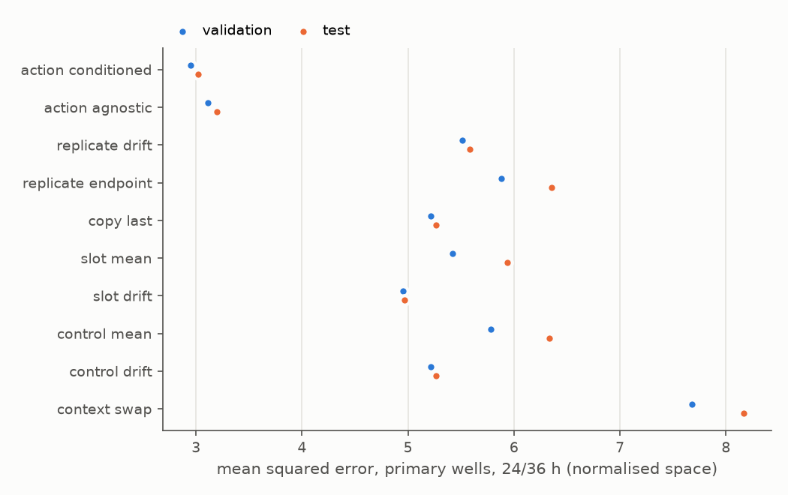
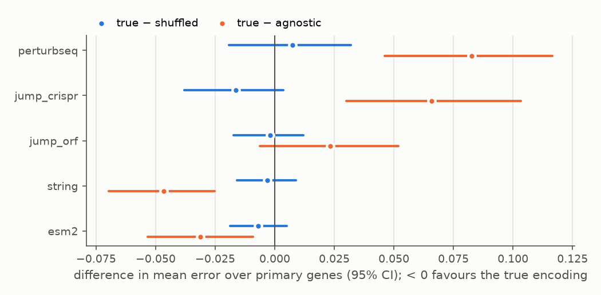
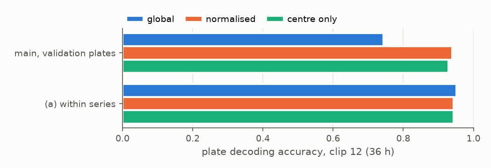

# GeneWorld stage 2 (amendment 02): run report

Generated by `scripts/90_run_report_stage2.py` from the results files; every number below is read from a file under `results/`. Test results: present.

## 1. Gates

| gate | validation | test |
|---|---|---|
| G-Signal-2 | pass | pass |
| G-ZeroShot-2 | fail | pass |
| G-Plan-2 | fail | fail |

Consequence on validation: G-Signal-2 passed: H2/H3 are confirmatory. Planning source: `jump_crispr`. Errata applied: E-02.1 (2026-10-22): G-Plan-2 trajectory comparator = kNN-imputed endpoint retrieval.

## 2. H1: action conditioning on seen genes (G-Signal-2)

**Validation:** 362 primary wells on 40 plates. The action-conditioned predictor beats (p = 5e-05) the action-agnostic predictor and beats (p = 1e-05) replicate drift; G-Signal-2 pass. Rule: primary wells, 24/36 h: action-conditioned beats action-agnostic and replicate drift, one-sided p < 0.05 over plates each.

| method | primary 24/36 h | all wells 24/36 h | action-conditioned vs this (primary) | p (plates) | p well-weighted (F6) |
|---|---|---|---|---|---|
| action_conditioned | 2.9484 | 2.6819 |  |  |  |
| action_agnostic | 3.1127 | 2.7413 | -6.2% | 5e-05 | 1e-05 |
| replicate_drift | 5.5144 | 5.3375 | -46.9% | 1e-05 | 1e-05 |
| replicate_endpoint | 5.8772 | 5.6114 | -50.5% | 1e-05 | 1e-05 |
| copy_last | 5.2174 | 4.6988 | -45.2% | 1e-05 | 1e-05 |
| slot_mean | 5.4192 | 4.894 | -44.9% | 1e-05 | 1e-05 |
| slot_drift | 4.9526 | 4.6173 | -41.3% | 1e-05 | 1e-05 |
| control_mean | 5.7798 | 4.9946 | -49.0% | 1e-05 | 1e-05 |
| control_drift | 5.2174 | 4.6988 | -45.2% | 1e-05 | 1e-05 |
| context_swap | 7.6793 | 7.1546 | -59.9% | 1e-05 | 1e-05 |

Replicate-baseline sources (fallback counts): `{"sirna": 4392, "gene_other_sirnas": 416, "fallback": 0}`.

Phenotype probe at 36 h (AUROC, 95% cluster-bootstrap CI over plates):

| class | n pos | n neg | AUROC by representation | differences |  |
|---|---|---|---|---|---|
| mitotic_delay | 70 | 4738 | observed 0.779 [0.7164, 0.8316] · action_conditioned 0.7 [0.6064, 0.7708] · action_agnostic 0.607 [0.5121, 0.6874] · replicate_drift 0.793 [0.731, 0.8422] · replicate_endpoint 0.916 [0.8245, 0.9787] | action_conditioned-action_agnostic: 0.093 [0.043, 0.1455] (higher) · action_conditioned-replicate_drift: -0.092 [-0.1659, -0.0354] (lower) |  |
| polylobed | 44 | 4764 | observed 0.839 [0.7419, 0.9186] · action_conditioned 0.914 [0.8695, 0.9612] · action_agnostic 0.784 [0.6911, 0.8669] · replicate_drift 0.924 [0.8786, 0.9563] · replicate_endpoint 0.963 [0.9087, 0.9974] | action_conditioned-action_agnostic: 0.13 [0.0716, 0.1949] (higher) · action_conditioned-replicate_drift: -0.01 [-0.0577, 0.0497] (not distinguishable) |  |
| binuclear | 134 | 4674 | observed 0.795 [0.746, 0.846] · action_conditioned 0.723 [0.6663, 0.7814] · action_agnostic 0.634 [0.5743, 0.692] · replicate_drift 0.816 [0.7734, 0.8569] · replicate_endpoint 0.921 [0.8875, 0.9495] | action_conditioned-action_agnostic: 0.089 [0.0603, 0.125] (higher) · action_conditioned-replicate_drift: -0.093 [-0.1305, -0.0467] (lower) |  |
| cell_death | 36 | 4772 | observed 0.846 [0.7603, 0.925] · action_conditioned 0.837 [0.7019, 0.9333] · action_agnostic 0.709 [0.562, 0.8196] · replicate_drift 0.82 [0.6847, 0.9398] · replicate_endpoint 0.924 [0.791, 0.9993] | action_conditioned-action_agnostic: 0.128 [0.0742, 0.1781] (higher) · action_conditioned-replicate_drift: 0.017 [-0.0627, 0.0961] (not distinguishable) |  |
| nuclear_shape | 223 | 4585 | observed 0.776 [0.732, 0.819] · action_conditioned 0.784 [0.7413, 0.8267] · action_agnostic 0.729 [0.6865, 0.7724] · replicate_drift 0.804 [0.7569, 0.8448] · replicate_endpoint 0.908 [0.8594, 0.9464] | action_conditioned-action_agnostic: 0.055 [0.0341, 0.0761] (higher) · action_conditioned-replicate_drift: -0.02 [-0.0552, 0.0175] (not distinguishable) |  |
| segregation | 109 | 4699 | observed 0.724 [0.6742, 0.7741] · action_conditioned 0.691 [0.6375, 0.7402] · action_agnostic 0.598 [0.5455, 0.6527] · replicate_drift 0.758 [0.7148, 0.7994] · replicate_endpoint 0.938 [0.9084, 0.9638] | action_conditioned-action_agnostic: 0.093 [0.0585, 0.1297] (higher) · action_conditioned-replicate_drift: -0.067 [-0.1084, -0.0229] (lower) |  |

**Test:** 770 primary wells on 82 plates. The action-conditioned predictor beats (p = 1e-05) the action-agnostic predictor and beats (p = 1e-05) replicate drift; G-Signal-2 pass. Rule: primary wells, 24/36 h: action-conditioned beats action-agnostic and replicate drift, one-sided p < 0.05 over plates each.

| method | primary 24/36 h | all wells 24/36 h | action-conditioned vs this (primary) | p (plates) | p well-weighted (F6) |
|---|---|---|---|---|---|
| action_conditioned | 3.02 | 2.6356 |  |  |  |
| action_agnostic | 3.1941 | 2.7131 | -5.7% | 1e-05 | 1e-05 |
| replicate_drift | 5.5805 | 5.1993 | -45.8% | 1e-05 | 1e-05 |
| replicate_endpoint | 6.3575 | 5.6278 | -53.1% | 1e-05 | 1e-05 |
| copy_last | 5.2651 | 4.546 | -42.5% | 1e-05 | 1e-05 |
| slot_mean | 5.9385 | 4.8924 | -49.4% | 1e-05 | 1e-05 |
| slot_drift | 4.9695 | 4.4627 | -38.8% | 1e-05 | 1e-05 |
| control_mean | 6.336 | 4.9879 | -52.5% | 1e-05 | 1e-05 |
| control_drift | 5.2651 | 4.546 | -42.5% | 1e-05 | 1e-05 |
| context_swap | 8.1653 | 7.156 | -62.5% | 1e-05 | 1e-05 |

Replicate-baseline sources (fallback counts): `{"sirna": 9161, "gene_other_sirnas": 803, "fallback": 0}`.

Phenotype probe at 36 h (AUROC, 95% cluster-bootstrap CI over plates):

| class | n pos | n neg | AUROC by representation | differences |  |
|---|---|---|---|---|---|
| mitotic_delay | 145 | 9819 | observed 0.737 [0.6823, 0.7893] · action_conditioned 0.745 [0.698, 0.7889] · action_agnostic 0.657 [0.6158, 0.6964] · replicate_drift 0.814 [0.7795, 0.8471] · replicate_endpoint 0.91 [0.8584, 0.9543] | action_conditioned-action_agnostic: 0.089 [0.0604, 0.1171] (higher) · action_conditioned-replicate_drift: -0.068 [-0.1105, -0.0288] (lower) |  |
| polylobed | 98 | 9866 | observed 0.782 [0.7297, 0.8402] · action_conditioned 0.86 [0.8244, 0.8954] · action_agnostic 0.724 [0.6722, 0.7777] · replicate_drift 0.897 [0.8665, 0.9256] · replicate_endpoint 0.956 [0.9195, 0.9842] | action_conditioned-action_agnostic: 0.137 [0.1006, 0.1718] (higher) · action_conditioned-replicate_drift: -0.037 [-0.0707, 0.0022] (not distinguishable) |  |
| binuclear | 259 | 9705 | observed 0.744 [0.7103, 0.7794] · action_conditioned 0.64 [0.5915, 0.6868] · action_agnostic 0.553 [0.509, 0.5985] · replicate_drift 0.753 [0.7117, 0.7944] · replicate_endpoint 0.917 [0.8938, 0.9393] | action_conditioned-action_agnostic: 0.087 [0.0647, 0.1081] (higher) · action_conditioned-replicate_drift: -0.113 [-0.1454, -0.0781] (lower) |  |
| cell_death | 88 | 9876 | observed 0.808 [0.7431, 0.8707] · action_conditioned 0.769 [0.691, 0.8512] · action_agnostic 0.699 [0.6186, 0.7867] · replicate_drift 0.844 [0.7705, 0.915] · replicate_endpoint 0.929 [0.8515, 0.9932] | action_conditioned-action_agnostic: 0.07 [0.026, 0.1144] (higher) · action_conditioned-replicate_drift: -0.075 [-0.1342, -0.023] (lower) |  |
| nuclear_shape | 480 | 9484 | observed 0.779 [0.7494, 0.8083] · action_conditioned 0.788 [0.7563, 0.8189] · action_agnostic 0.724 [0.6914, 0.7598] · replicate_drift 0.799 [0.7681, 0.8285] · replicate_endpoint 0.91 [0.8817, 0.9351] | action_conditioned-action_agnostic: 0.063 [0.043, 0.0846] (higher) · action_conditioned-replicate_drift: -0.011 [-0.0344, 0.0103] (not distinguishable) |  |
| segregation | 230 | 9734 | observed 0.667 [0.6254, 0.7096] · action_conditioned 0.649 [0.6036, 0.6967] · action_agnostic 0.56 [0.515, 0.6066] · replicate_drift 0.736 [0.7033, 0.7692] · replicate_endpoint 0.936 [0.9127, 0.9577] | action_conditioned-action_agnostic: 0.09 [0.0675, 0.1116] (higher) · action_conditioned-replicate_drift: -0.087 [-0.1206, -0.0531] (lower) |  |

*Global preprocessing (sensitivity), validation:* vs action-agnostic -6.9% (beats (p = 0.001)); vs replicate drift -49.0% (beats (p = 1e-05)).

*DINOv2, validation:* vs action-agnostic -4.8% (beats (p = 2e-05)); vs replicate drift -48.7% (beats (p = 1e-05)).

*TiJepa-1, validation:* vs action-agnostic -2.1% (does not beat (p = 0.082)); vs replicate drift -58.9% (beats (p = 1e-05)).

*ScreenB (global, outside the gates):* vs action-agnostic -0.8% (does not beat (p = 0.102)); vs replicate drift -36.6% (beats (p = 1e-05)).

## 3. H2: zero-shot transfer to unseen genes (G-ZeroShot-2)

**Validation:** G-ZeroShot-2 fail (passing sources: none). Rule: on primary genes at 24/36 h, >= 1 source: true - trained-shuffled 95% CI over genes below 0 and true - action-agnostic 95% CI below 0.

| source | primary genes | true − shuffled | 95% CI |  | true − agnostic | 95% CI |  | pass |
|---|---|---|---|---|---|---|---|---|
| perturbseq | 108 | 0.0075 | [-0.0192, 0.0319] | not distinguishable | 0.0826 | [0.0461, 0.1166] | higher | fail |
| jump_crispr | 90 | -0.0164 | [-0.038, 0.0037] | not distinguishable | 0.0657 | [0.03, 0.1034] | higher | fail |
| jump_orf | 139 | -0.002 | [-0.0172, 0.0119] | not distinguishable | 0.0232 | [-0.0063, 0.0519] | not distinguishable | fail |
| string | 195 | -0.0031 | [-0.0159, 0.0088] | not distinguishable | -0.0467 | [-0.0697, -0.0253] | lower | fail |
| esm2 | 196 | -0.0071 | [-0.0188, 0.0051] | not distinguishable | -0.0311 | [-0.0532, -0.0092] | lower | fail |

**Test:** G-ZeroShot-2 pass (passing sources: string). Rule: on primary genes at 24/36 h, >= 1 source: true - trained-shuffled 95% CI over genes below 0 and true - action-agnostic 95% CI below 0.

| source | primary genes | true − shuffled | 95% CI |  | true − agnostic | 95% CI |  | pass |
|---|---|---|---|---|---|---|---|---|
| perturbseq | 215 | 0.000243 | [-0.014, 0.0144] | not distinguishable | 0.0894 | [0.0688, 0.1107] | higher | fail |
| jump_crispr | 214 | -0.0108 | [-0.0345, 0.007] | not distinguishable | 0.0592 | [0.0359, 0.081] | higher | fail |
| jump_orf | 273 | -0.0018 | [-0.0108, 0.0072] | not distinguishable | 0.0452 | [0.0315, 0.0598] | higher | fail |
| string | 396 | -0.0088 | [-0.0176, -0.0001082] | lower | -0.039 | [-0.0507, -0.0276] | lower | pass |
| esm2 | 403 | -0.0042 | [-0.012, 0.0037] | not distinguishable | -0.0284 | [-0.0397, -0.0172] | lower | fail |

*Global preprocessing, validation:* G-ZeroShot-2 rule fail

*Complex split, validation:* G-ZeroShot-2 rule fail

## 4. H3: planning (G-Plan-2)

**Validation:** phenotype half fail, trajectory half fail; G-Plan-2 fail. Rule: phenotype (primary truth, unseen genes) and trajectory rules; trajectory: hit@100 above random (binomial p < 0.05) and above kNN-imputed endpoint retrieval (bootstrap CI over target genes above 0), erratum E-02.1.

| trajectory method | hit@1 | hit@10 | hit@100 | MRR | median rank |
|---|---|---|---|---|---|
| planner | 0 | 0.006 | 0.029 | 0.003 | 2930.5 |
| retrieval_knn | 0 | 0.004 | 0.035 | 0.002 | 3065.5 |
| oracle_ceiling_replicate_endpoint | 0.006 | 0.054 | 0.169 | 0.023 | 1232.5 |
| random | 0.000153 | 0.002 | 0.015 |  |  |

480 targets (90 genes), 6518 candidates. Planner vs random hit@100: binomial p = 0.018. Planner − `retrieval_knn` (gate comparator, erratum E-02.1): -0.016 [-0.0503, 0.0153] (not distinguishable). `oracle_ceiling_replicate_endpoint` = oracle ceiling (uses the unseen gene's observed wells).

**Test:** phenotype half fail, trajectory half fail; G-Plan-2 fail. Rule: phenotype (primary truth, unseen genes) and trajectory rules; trajectory: hit@100 above random (binomial p < 0.05) and above kNN-imputed endpoint retrieval (bootstrap CI over target genes above 0), erratum E-02.1.

| trajectory method | hit@1 | hit@10 | hit@100 | MRR | median rank |
|---|---|---|---|---|---|
| planner | 0 | 0.006 | 0.022 | 0.003 | 3322 |
| retrieval_knn | 0 | 0.01 | 0.03 | 0.005 | 3122 |
| oracle_ceiling_replicate_endpoint | 0.008 | 0.052 | 0.162 | 0.025 | 1400 |
| random | 0.000153 | 0.002 | 0.015 |  |  |

500 targets (192 genes), 6526 candidates. Planner vs random hit@100: binomial p = 0.15. Planner − `retrieval_knn` (gate comparator, erratum E-02.1): -0.012 [-0.0368, 0.0099] (not distinguishable). `oracle_ceiling_replicate_endpoint` = oracle ceiling (uses the unseen gene's observed wells).

*Global preprocessing, validation:* G-Plan-2 rule fail

*Complex split, validation:* G-Plan-2 rule fail

## 5. Data, exclusions and missing frames

Stage 2 embedded 60,289 of 61,372 selected wells on 404 of 410 plates.

S2 (HEAD on every level-1 frame chunk, 3 attempts, back-off 1/2/4 s): 1,083 wells failed; 21,184 of 100,719 frames missing; 0 recovered; whole plates lost: LT0003_40, LT0008_14, LT0012_29, LT0079_38, LT0084_46, LT0096_29.

| split | wells lost | plates | H1 primary wells | primary-gene wells | missing only frames ≥ 88 (F9) |
|---|---|---|---|---|---|
| train | 745 | 26 | 0 | 194 | 532 |
| val | 338 | 4 | 33 | 70 | 336 |

S3 accounting, test: see `results/a2/missing_frames_test.json`

S3 accounting, screenB: see `results/a2/missing_frames_screenB.json`

## 6. Plate-identity probes and R1

| probe | chance | global | normalised | centre only |
|---|---|---|---|---|
| main: validation plates | 0.02 | 0.744 | 0.939 | 0.929 |
| (a) within-series replicates | 0.31 | 0.951 | 0.944 | 0.943 |
| (b) negative controls, leave-one-out (uninformative after normalisation; global value only) | 0.02 | 0.509 | uninformative | uninformative |

## 7. Grid, selection and hardware

288 grid runs: {"complete": 288, "running": 0, "pending": 0, "failed": 0}; completed on {"old instance, 1 x A100-40GB (single GPU)": 76, "new instance, 8 x A100-SXM4-40GB": 212}; failed attempts by incident {"1": 277, "2": 13, "3": 27} (`results/a2/grid_runs.json`; reconstructed values are labelled there).

Note: incident 2: the runner log shows 13 failed attempts (07:27:21-07:31:21 UTC 10-22); reports/AMEND02_PROGRESS.md said 12.

| family | selected configuration |
|---|---|
| h1_learned | 50M_d0.1_w0.2 |
| h1_none | 50M_d0.3_w0.05 |
| h2:perturbseq | 50M_d0.3_w0.2 |
| h2:jump_crispr | 50M_d0.3_w0.2 |
| h2:jump_orf | 50M_d0.3_w0.2 |
| h2:string | 50M_d0.3_w0.2 |
| h2:esm2 | 50M_d0.3_w0.2 |
| h2shuf:perturbseq | 50M_d0.3_w0.2 |
| h2shuf:jump_crispr | 50M_d0.3_w0.2 |
| h2shuf:jump_orf | 50M_d0.3_w0.2 |
| h2shuf:string | 50M_d0.3_w0.2 |
| h2shuf:esm2 | 50M_d0.3_w0.2 |

| validation job | GPU | minutes | exit |
|---|---|---|---|
| grid | 0,1,2,3,4,5,6,7 | 0.1 | 0 |
| grid_record | CPU | 0.1 | 0 |
| selection | CPU | 0.1 | 0 |
| h2_val | 0 | 9.4 | 0 |
| h1_val | 1 | 15.1 | 0 |
| controls_plate | 2 | 0.7 | 0 |
| secondary | 3,4,5,6,7 | 327.1 | 0 |
| h3_val | 0 | 74.1 | 0 |
| secondary_complex | 0,1,2,3 | 0.1 | 0 |
| h1_val_global | 4 | 24.9 | 0 |
| h2_val_global | 5 | 10.0 | 0 |
| h3_val_global | 6 | 78.1 | 0 |
| h1_val_dinov2 | 7 | 14.8 | 0 |
| h1_val_tijepa1 | 0 | 18.8 | 0 |
| controls_global | 1 | 0.6 | 0 |
| h2_val_complex | 2 | 1.8 | 0 |
| h3_val_complex | 3 | 74.3 | 0 |
| gates | CPU | 0.1 | 0 |

## 8. Controls

plate: static-clip ratio 3.682; leakage max r 0.586, 0 matches r ≥ 0.98

global: static-clip ratio 3.499; leakage max r 0.586, 0 matches r ≥ 0.98

## 9. Incidents and deviations

| grid incident | failed attempts |
|---|---|
| 1: 2026-10-21 CUDA out-of-memory, 4 processes on one 40 GB GPU | 277 |
| 2: 2026-10-22 07:27-07:31 UTC CUDA out-of-memory, three 50 M runs on one 40 GB GPU | 13 |
| 3: 2026-10-23 06:20 UTC unattended OS upgrade restarted the NVIDIA services (logs/migration/incident_1023_nvidia_restart.log) | 27 |

The S12 orchestrator stopped before any selection or evaluation when the grid record (`scripts/73_grid_record.py`) failed on an undated runner section; each attempt's job record is kept (`results/a2/eval_jobs_attempt<n>.json`). No result was produced by a stopped attempt.

| attempt | stopped at job | stopped (UTC) | hours to restart |
|---|---|---|---|
| S12 attempt 1 | `grid_record` exit 1 | 2026-10-23T16:27:06Z | 54.5 |
| S12 attempt 2 | `grid_record` exit 1 | 2026-10-25T22:55:01Z | 0 |

The 9 complex-split secondary runs were trained by a complex-only runner started while the gene-split secondary runner finished (completion plan parallelisation); the orchestrator's `secondary_complex` step then found no run left (0.1 min). Same configurations, seeds and inputs.

S18 rehearsal: 36 step runs, 1 failed (`h2_global`; each rerun later with exit 0, see `logs/rehearsal/`).

Test evaluation: 36 step runs, 0 failed.

E1-E3: 21 step runs, 1 failed (`e2`; each rerun later with exit 0, see `logs/exploratory/`).

## 10. Not run

Every planned step has a results file.

## Exploratory, after the test

Every number in this section is exploratory, after the test, and is never used to revise a gate or claim.

E1 (val): vs action-agnostic beats (p = 1e-05); vs replicate drift beats (p = 1e-05)

E1 (test): vs action-agnostic beats (p = 1e-05); vs replicate drift beats (p = 1e-05)

| E2 representation | series | mean accuracy | chance |
|---|---|---|---|
| observed_clip12 | 76 | 0.944 | 0.31 |
| observed_clip0 | 76 | 0.942 | 0.31 |
| forecast_learned | 76 | 0.95 | 0.31 |
| forecast_agnostic | 76 | 0.952 | 0.31 |

E3: {"val": {"n_wells_primary": [362, 386], "G_Signal_2_pass": [true, true], "conclusion_differs": false}, "test": {"n_wells_primary": [770, 770], "G_Signal_2_pass": [true, true], "conclusion_differs": false}}
